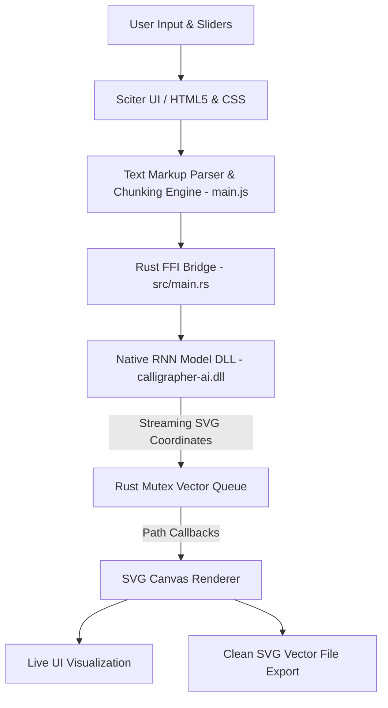

# Project Synopsis: Calligrapher AI – Neural Network-Powered Dynamic Handwriting Synthesis Desktop Application

---

## 1. Executive Summary

**Calligrapher AI** is a high-performance, offline desktop application designed to convert digital text into realistic, human-like handwritten vector graphics using Recurrent Neural Networks (RNN). Built on a hybrid architecture combining **Rust**, **Sciter.JS (HTML/CSS/Modern JS)**, and a native **C/C++ RNN Inference Engine (`calligrapher-ai.dll`)**, the application synthesizes unique stroke variations, cursive ligatures, and pressure dynamics that avoid the mechanical repetition of standard digital handwriting fonts.

The platform enhances the core synthesis algorithm with an **intelligent word-boundary chunking engine**, an **in-line rich-text formatting markup parser (`\[RRGGBB]`, `\n`, `\{N}`)**, an **expanded 2,000+ character capacity**, and a **real-time SVG vector rendering and export pipeline**.

---

## 2. Problem Statement

* **Repetitive & Mechanical Digital Fonts:** Traditional handwriting fonts (TTF/OTF) repeat identical glyph shapes for the same characters, making generated text look artificial and easily identifiable as machine-generated.
* **Severe Input Length Bottlenecks:** Raw RNN handwriting synthesis models are constrained by character-length limits ($\approx 50$ characters), causing stroke distortion, baseline drift, or crashes when processing long sentences or paragraphs.
* **Lack of Text Customization:** Existing handwriting generators lack fine-grained control over multi-color ink, line spacing, margins, or inline style variations within the same document.
* **Cloud Dependency & Latency:** Most AI generation tools rely on remote cloud APIs, introducing latency, privacy issues with confidential documents, and internet dependency.

---

## 3. Core Objectives

* **Offline Neural Synthesis:** Deliver real-time, local handwriting synthesis without external cloud API dependencies.
* **Paragraph-Scale Generation:** Implement an intelligent chunking and baseline-alignment algorithm to scale input limits from 50 to **2,000+ characters** across multiple lines.
* **Rich-Text Markup Support:** Enable multi-colored ink (`\[RRGGBB]`), custom paragraph line-breaks (`\n`), and horizontal indentation spacing (`\{N}`).
* **Granular Parameter Control:** Provide real-time UI controls to adjust stroke speed, legibility, stroke thickness, and handwriting styles (print vs. cursive styles).
* **Vector Graphic Export:** Export generated handwriting as resolution-independent, scalable vector graphics (**SVG**) with accurate `viewBox` bounding boxes and white backgrounds.

---

## 4. System Architecture & Tech Stack

### Technology Breakdown

| Component | Technology / Framework | Role in Project |
| :--- | :--- | :--- |
| **Desktop Application Core** | **Rust** (`2018/2021 Edition`, `sciter-rs`) | High-performance host application, windowing, multi-threading, and FFI coordination. |
| **GUI & UI Layer** | **Sciter.JS** (HTML5, Vanilla CSS, ES6+ JS) | Lightweight, native-rendered desktop UI with low memory footprint and zero external runtime bloat. |
| **Neural Inference Engine** | **C/C++ Dynamic Library** (`calligrapher-ai.dll`) | Low-level execution of Alex Graves' recurrent neural network stroke synthesis model. |
| **FFI & Memory Bridge** | `libloading`, `libc`, `lazy_static` (Rust) | Dynamically links to the C-ABI DLL, passes string pointers, and coordinates thread-safe callbacks. |
| **Asset Packaging** | Sciter `packfolder.exe` & `build.rs` | Compiles HTML/JS/CSS assets directly into the standalone binary (`assets.rc`). |
| **Vector Rendering** | Native SVG Engine (`<svg>`, `<g>`, `<path>`) | Real-time vector rendering, coordinate translation, and SVG XML export. |

---

## 5. Key Modules & Functional Features

### A. Intelligent Chunking & Coordinate Alignment Engine
* **Word-Boundary Splitting (`splitIntoChunks`):** Automatically divides large text blocks into sub-50 character segments without breaking words.
* **Dynamic Coordinate Translation:** Measures `modelStartX` and `modelEndX` directly from generated SVG path data, aligning subsequent chunks seamlessly along the $X$-axis without scale distortion.
* **Auto Canvas Height Expansion:** Calculates dynamic vertical baselines (`LINE_STEP`) and expands SVG canvas height when multi-line text exceeds visible boundaries.

### B. Custom Rich-Text Markup Parser (`parseFormattedText`)
* **Multi-Color Ink (`\[RRGGBB](text)`):** Allows users to highlight phrases, headings, or keywords in distinct colors (e.g., `\[FF0000](Important Note)`).
* **Forced Line Breaks (`\n`):** Shifts the $Y$-baseline downward to create paragraph breaks and lists.
* **Space Multipliers (`\{N}`):** Adjusts horizontal indentation and column gaps programmatically.

### C. Synthesis Parameter Tuning
* **Speed Slider (`0.6` - `9.5`):** Adjusts the simulated pen velocity and stroke curvature.
* **Legibility Slider (`0.15` - `2.5`):** Modulates the model sampling temperature (higher values yield neat, uniform script; lower values yield casual, messy script).
* **Thickness Slider (`0.1` - `1.5`):** Adjusts pen stroke width.
* **Style Selector (1–9 & Random):** Selects distinct handwriting biases and style seeds.

### D. Vector File Exporter
* Saves high-resolution, print-ready SVG files containing complete vector path definitions, correct viewport bounding coordinates, and standard XML declarations for use in design tools (Figma, Illustrator, Inkscape) or digital pen plotters.

---

## 6. Basic Workflow Pipeline

1. **Input:** User enters text (with optional `\[RRGGBB]`, `\n`, or `\{N}` syntax) and adjusts style sliders.
2. **Parsing:** `parseFormattedText()` tokenizes raw text into styled segments.
3. **Chunking:** `splitIntoChunks()` splits long strings into $\le 50$-character tokens at whitespace boundaries.
4. **Execution:** For each chunk, Sciter invokes the Rust backend (`EventHandler::write`), which launches a background thread calling `calligrapher-ai.dll`.
5. **Streaming:** The RNN streams path coordinates back to Rust via C callbacks, which are placed into a thread-safe `Mutex<Vec<String>>` and sent to the frontend.
6. **Rendering:** Sciter creates grouped `<g>` SVG elements with calculated offsets (`currentX`, `currentLineY`).
7. **Export:** User clicks the save icon to export a standalone `.svg` vector file.

---

## 7. Expected Outcomes & Impact

* **High-Quality Realistic Output:** Produces authentic handwriting that looks natural and varied across letters, words, and paragraphs.
* **Robust Long-Form Generation:** Capable of synthesizing essays, letters, and multi-colored documents without crashing or overflowing.
* **Zero Resource Overhead:** Completely standalone, portable executable running smoothly with minimal RAM and CPU utilization.
* **Applications:** Useful for automated handwritten letter generation, personalized marketing, educational notes, artistic calligraphy, and vector-driven pen plotter hardware.

---

## 8. Future Roadmap

* **Multi-Line Visual Textarea:** Upgrading the single-line input to an integrated code editor with live syntax highlighting for formatting tags.
* **Ruled Paper & Margin Overlays:** Introducing background paper templates (lined, grid, legal pad) with automatic margin-wrapping.
* **Direct PDF/PNG Export:** Adding multi-page PDF generation alongside vector SVG export.
* **Custom Style Training Pipeline:** Supporting fine-tuning or user-provided handwriting samples to clone individual handwriting styles.

---

## 9. Conclusion

**Calligrapher AI** bridges the gap between deep-learning handwriting synthesis models and practical desktop software. By implementing an intelligent chunking pipeline, real-time coordinate stitching, rich-text markup parsing, and low-latency Rust/Sciter architecture, the project provides a scalable, fully offline solution for realistic vector handwriting generation.
