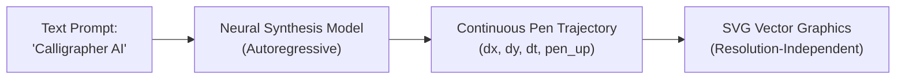
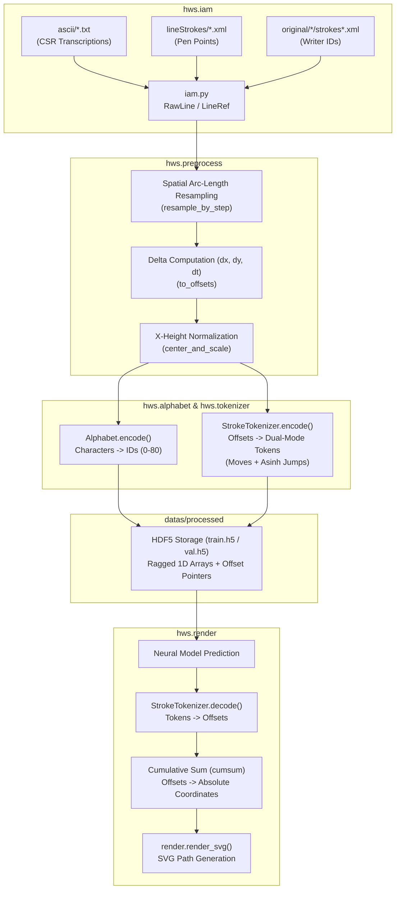
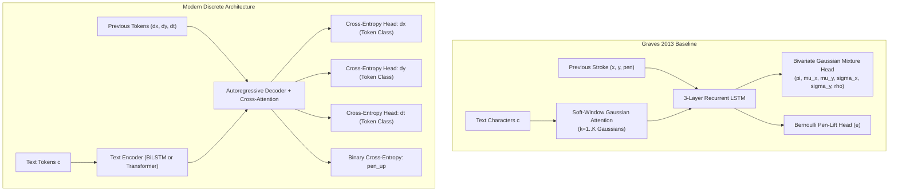

# The Definitive, Zero-Jargon Guide to Online Handwriting Synthesis (`hws`)
### *A 100% Self-Contained Master Reference for Engineering, Architecture, Mathematics, and College Viva Defense*

---

## Table of Contents
1. [No-Google Plain-English Glossary (All Terms Defined)](#1-no-google-plain-english-glossary-all-terms-defined)
2. [Executive Overview & Foundational Concepts](#2-executive-overview--foundational-concepts)
3. [End-to-End System Architecture & Dataflow](#3-end-to-end-system-architecture--dataflow)
4. [Deep Dive into the IAM-OnDB Dataset & Real-World Quirks](#4-deep-dive-into-the-iam-ondb-dataset--real-world-quirks)
5. [Mathematical & Coordinate Foundations (With Intuition Behind Every Formula)](#5-mathematical--coordinate-foundations-with-intuition-behind-every-formula)
6. [The Preprocessing Pipeline: Step-by-Step](#6-the-preprocessing-pipeline-step-by-step)
7. [The Discrete Stroke Tokenizer (`hws.tokenizer`)](#7-the-discrete-stroke-tokenizer-hwstokenizer)
8. [The Alphabet & Vocabulary System (`hws.alphabet`)](#8-the-alphabet--vocabulary-system-hwsalphabet)
9. [Neural Architecture: Graves 2013 MDN vs. Modern Discrete Synthesis](#9-neural-architecture-graves-2013-mdn-vs-modern-discrete-synthesis)
10. [Vector Rendering Pipeline (`hws.render`)](#10-vector-rendering-pipeline-hwsrender)
11. [Storage Infrastructure: Ragged HDF5 Format](#11-storage-infrastructure-ragged-hdf5-format)
12. [Numerical Walkthrough of a Single Sample: From XML to SVG](#12-numerical-walkthrough-of-a-single-sample-from-xml-to-svg)
13. [Comprehensive College Viva Voce Questions & Model Answers](#13-comprehensive-college-viva-voce-questions--model-answers)
14. [CLI Commands & Verification Playbook](#14-cli-commands--verification-playbook)

---

## 1. No-Google Plain-English Glossary (All Terms Defined)

*Read this section once. You will never need to search the web for any jargon used in this project.*

### General & Typography Terms
* **Online Handwriting:** Handwriting captured as a **time-series of pen movements** (coordinates + time) as the person writes on a sensor or screen. (Not related to the internet).
* **Offline Handwriting:** Handwriting stored as a **static image / picture** (like a scanned photo or PNG).
* **Ligature:** The smooth connecting stroke that links two cursive letters together (e.g., the loop linking *'c'* to *'a'* in *"cat"*).
* **X-Height ($h_x$):** In typography, the physical height of standard lowercase letters that don't have tall stems (like *'x', 'a', 'c', 'e', 'm'*). Ascenders (tall parts of *'b', 'd', 'k'*) stick above the x-height; descenders (tails of *'g', 'p', 'y'*) drop below the baseline.
* **Vector Graphics (SVG):** An image defined by mathematical commands (e.g., *"draw a curve from (10, 20) to (50, 80)"*) rather than colored pixels. You can zoom in infinitely and it never pixelates or gets blurry.
* **Raster / Bitmap Graphics:** Images made of a fixed grid of colored pixels (like JPEG or PNG). Zooming in makes them blurry.

### Coordinate & Data Engineering Terms
* **Delta / Offset ($\Delta x, \Delta y, \Delta t$):** The *change* or step from the current point to the next point ($\Delta x = x_{\text{new}} - x_{\text{old}}$), rather than the absolute coordinate on the screen.
* **Translation Invariance:** A mathematical property meaning a shape or calculation remains identical regardless of where it is placed on a page (drawing an *'A'* at the top-left uses the exact same deltas as drawing an *'A'* at the bottom-right).
* **Cumulative Sum (`cumsum`):** Adding numbers sequentially. If steps are $[+2, +3, -1]$, the cumsum coordinates are $[2, 2+3=5, 5-1=4]$.
* **Arc-Length ($s$):** The total physical distance traveled along a curved path as if you laid a piece of string along the drawn stroke and measured its length with a ruler.
* **Ragged Array:** A dataset where every sample has a different length (e.g., Sentence 1 has 150 points, Sentence 2 has 400 points) stored efficiently without wasting space.
* **Data Leakage:** A critical machine learning mistake where information or statistics from the validation/test dataset accidentally contaminate the training process, causing overly optimistic validation scores.

### Probability & Machine Learning Terms
* **Autoregressive Model:** A model that generates output step-by-step, using its own previous predictions as input for the next step (like ChatGPT generating one word at a time, or our model drawing one stroke coordinate at a time).
* **Cross-Entropy Loss:** The standard mathematical score used to train classification models. It measures how confident the model was in predicting the correct category/bin. It is numerically stable and never blows up.
* **Bivariate Gaussian Distribution:** A 2D bell-curve probability surface describing the likelihood of a 2D coordinate $(x, y)$. It is defined by 5 parameters: center $(\mu_x, \mu_y)$, spreads/widths $(\sigma_x, \sigma_y)$, and diagonal tilt/correlation $\rho$.
* **Mixture Density Network (MDN):** A neural network that predicts multiple Gaussian bell curves simultaneously.
* **Mode Collapse:** A machine learning failure where a model gets confused by multiple valid options and either picks only one forever or predicts an average of both (e.g., drawing a blurry straight line between two distinct cursive letters).
* **Heavy-Tailed Distribution:** A statistical distribution where most numbers are small (e.g., small pen steps $\le 5$), but a few numbers are extremely large (e.g., airborne jumps up to $77$).
* **Quantile Binning:** Dividing data into bins so that every bin contains the exact same *number of data points*.
* **Inverse Hyperbolic Sine ($\text{asinh}$):** A mathematical transformation curve $\text{asinh}(z) = \ln(z + \sqrt{z^2 + 1})$. It behaves linearly for small numbers near zero and logarithmically for huge numbers in the tails.

---

## 2. Executive Overview & Foundational Concepts

### 2.1 The Core Mission
Given an input text string (e.g., `"Hello World"`) and an optional human style ID, synthesize authentic, human-like pen strokes that connect naturally, preserve cursive dynamics, and render into crisp, scalable SVG vector graphics.



### 2.2 Why Not Just Use Fonts?
Standard digital fonts (TTF/OTF) simply stamp pre-drawn glyph images. In the word *"banana"*, all three *'a'*s and both *'n'*s are mathematically identical duplicates. Human handwriting never repeats identical geometry; it features dynamic speed variations, ligature bridges, and variable slant. This model generates **unique, non-repetitive strokes** probabilistically on every run.

---

## 3. End-to-End System Architecture & Dataflow



---

## 4. Deep Dive into the IAM-OnDB Dataset & Real-World Quirks

The **IAM On-Line Handwriting Database** was recorded using digital whiteboards (eBeam systems) with infrared/ultrasound tracking pens at the University of Bern.

### 4.1 The Three File Folders Explained

```text
datas/raw/iam-ondb/
├── ascii/          --> Transcriptions (1 text file per page)
│   └── a01/a01-000/a01-000u.txt
├── lineStrokes/    --> The actual pen coordinates chopped into individual lines
│   └── a01/a01-000/a01-000u-01.xml, a01-000u-02.xml ...
└── original/       --> Full unsegmented page recording (Contains Writer IDs)
    └── a01/a01-000/strokesu.xml
```

### 4.2 The "CSR vs. OCR" Ground-Truth Trap

Every `ascii/*.txt` file contains two distinct sections:
```text
OCR:
By Trevor Williams. A move to stop Mr. Gaitskell from nominating any more...

CSR:
By Trevor Williams. A move to stop Mr. Gaitskell from nomnating any more...
```

* **`OCR:` block** = The printed prompt the human was *instructed* to write.
* **`CSR:` block** = What the human *actually physically wrote* (notice the typo: *"nomnating"*).

> **Why this matters:** Human writers make typos and skip letters. The whiteboard pen strokes record the physical mistake (*"nomnating"*). If you train an AI model against the `OCR:` label, you are forcing the model to associate a 9-letter stroke sequence with a 10-letter word. **Only the `CSR:` block provides correct ground truth.**

### 4.3 Missing Metadata in `original/`
* In `lineStrokes/`, XML files do **not** record who wrote the line.
* The writer ID exists **only** in `original/*/strokes*.xml` inside the `<Form writerID="10028"/>` tag.
* In early recording sessions (~332 out of 1,907 forms), the recording software did not record `<General><Form/></General>`.
* **How our code handles this:** [`load_writer_ids()`](file:///c:/Users/basub/OneDrive/Desktop/AR-Handwriting%20Synthesis/Handrwitten/hws/iam.py#L251) streams XML files using `iterparse`. If no writer ID tag exists, it sets `writer_id = None`. The strokes and text are **not wasted**; they are still used for training general handwriting synthesis.

### 4.4 Non-Monotonic Timestamps & Form Discrepancies
* **Negative $\Delta t$:** In ~0.25% of lines, the whiteboard sensor timer jumped backwards (e.g., a $-746\,\text{s}$ step). These lines are filtered out because negative time makes pen velocity impossible.
* **Line Count Mismatches:** If an ascii file has 5 lines of CSR text but the folder has 6 stroke XML files, the entire form is discarded. Slicing partially mismatched pairs would misalign every subsequent line.

### 4.5 Writer-Disjoint Splitting (Preventing Memorization)
* In IAM, each human volunteer wrote multiple pages.
* If you perform a naive random split, lines from Writer #10028 will end up in both training and validation sets. The validation score would then measure the model's ability to *memorize* that specific handwriting style.
* **Writer-Disjoint Split:** 156 writers are strictly reserved for `train.h5`, 20 distinct writers for `val.h5`, and 20 distinct writers for `test.h5`. This guarantees that validation measures true **generalization to unseen human writers**.

---

## 5. Mathematical & Coordinate Foundations (With Intuition Behind Every Formula)

### 5.1 The Coordinate Inversion ($+y$ Direction)
* **Computer Screens, Whiteboard Digitizers & SVG:** Coordinate $(0,0)$ is top-left. Moving right is $+x$; **moving DOWN is $+y$**.
* **Standard Mathematics & Neural Networks:** Cartesian plane. Moving right is $+x$; **moving UP is $+y$**.

```
Screen / Sensor Space (+y DOWN):        Math / Model Space (+y UP):
(0,0) ───────> +x                       +y ▲
  │                                        │
  │                                        │
  ▼ +y                                     (0,0) ───────> +x
```

* **Rule:** [`parse_stroke_xml()`](file:///c:/Users/basub/OneDrive/Desktop/AR-Handwriting%20Synthesis/Handrwitten/hws/iam.py#L160) negates $y$ immediately at ingestion ($y_{\text{math}} = -y_{\text{sensor}}$). All preprocessing and model tensors operate in $+y=\text{up}$. Flipping back to $+y=\text{down}$ happens in exactly one place: [`hws/render.py`](file:///c:/Users/basub/OneDrive/Desktop/AR-Handwriting%20Synthesis/Handrwitten/hws/render.py) when emitting SVG paths.

### 5.2 The (N, 4) Column Array Layout
Every stroke sequence is an $(N, 4)$ matrix with four columns:

$$\mathbf{P}_i = \begin{bmatrix} x_i & y_i & \text{pen\_up}_i & t_i \end{bmatrix}$$

| Column Index | Named Constant | Point Interpretation | Offset Interpretation |
| :---: | :--- | :--- | :--- |
| `0` | `X` | Absolute horizontal coordinate $x$ | Horizontal step $\Delta x_i = x_i - x_{i-1}$ |
| `1` | `Y` | Inverted vertical coordinate $y$ ($+y=\text{up}$) | Vertical step $\Delta y_i = y_i - y_{i-1}$ |
| `2` | `PEN_UP` | $1.0$ if pen lifts **after** point $i$; else $0.0$ | Carried through ($1.0$ if pen lifted after step $i$) |
| `3` | `TIME` | Elapsed seconds since line start ($t_0 = 0.0$) | Time delta $\Delta t_i = t_i - t_{i-1}$ |

---

### 5.3 Delta Offsets Formulation

#### The Formula:
$$\Delta x_i = x_i - x_{i-1}, \quad \Delta y_i = y_i - y_{i-1}, \quad \Delta t_i = t_i - t_{i-1}$$

#### Plain-English Intuition:
Instead of telling the model *"the pen is at position (1420, 850) on the whiteboard"*, we tell the model *"move the pen +2 units right and +3 units up from where you currently are"*.

#### Why this is essential:
1. **Translation Invariance:** The motion to draw the letter *'e'* is identical whether written in the top-left margin or bottom-right corner.
2. **Infinite Canvas:** The model can generate multi-line paragraphs simply by moving the starting cursor, without retraining.

#### Position Reconstruction via Cumulative Sum (`cumsum`):
To turn predicted deltas back into a visible drawing:

$$x_t = x_0 + \sum_{k=1}^t \Delta x_k, \quad y_t = y_0 + \sum_{k=1}^t \Delta y_k$$

---

### 5.4 The "Pen-Up" Indexing Nuance (The $i+1$ Shift)

#### The Rule:
`PEN_UP = 1.0` on row $i$ means: *"The pen tip is on the paper at point $i$, and lifts into the air IMMEDIATELY AFTER point $i$"*.

#### The Nuance:
* Point $i$ was drawn on the paper.
* The **airborne flight** to the next letter/word occurs during transition **$i \to i+1$**.
* Therefore, in the offset array, the airborne jump is row **$i+1$**.
* **Code Implementation:** The jump mask is shifted by one: `is_jump[j] = (pen_up[j - 1] == 1.0)`. Getting this wrong causes the model to classify on-paper drawing strokes as airborne jumps.

---

## 6. The Preprocessing Pipeline: Step-by-Step

[`hws/preprocess.py`](file:///c:/Users/basub/OneDrive/Desktop/AR-Handwriting%20Synthesis/Handrwitten/hws/preprocess.py) prepares raw sensor coordinates in five deterministic steps:

```
[Raw Points (N, 4)]
        │
        ▼ 1. Spatial Arc-Length Resampling (resample_by_step)
[Uniformly Spaced Points (M, 4)]
        │
        ▼ 2. Compute Offset Deltas (to_offsets)
[Offsets (dx, dy, pen_up, dt)]
        │
        ▼ 3. Estimate Corpus X-Height & Normalize (center_and_scale)
[Zero-Centered, Scale-Normalized Offsets]
```

### Step 1: Spatial Arc-Length Resampling

#### The Formula:
Cumulative path distance $s$ along a stroke of $N$ points:

$$s_0 = 0, \quad s_i = s_{i-1} + \sqrt{(x_i - x_{i-1})^2 + (y_i - y_{i-1})^2}$$

#### Plain-English Intuition:
Whiteboard sensors record at a constant clock speed (100 times per second). 
* When a human pauses or writes slowly, the sensor records hundreds of points on top of each other.
* When a human writes quickly, points are spread far apart.
* **Resampling** ignores the clock and places points at **equal physical distances** along the stroke line (like placing milestones every 10 meters along a winding road).

#### Practical Impact:
Applying `--step-factor 2.0` compresses the median sequence length from **620 points to 342 points (1.84× sequence compression)**. This cuts recurrent/attention training compute in half with zero loss of visual quality.

---

### Step 2: X-Height Normalization

#### Plain-English Intuition:
Some humans write with huge 2-inch letters; others write with tiny 0.5-inch letters. If fed raw into a neural network, the model gets confused by scale. 
* We estimate the **$x$-height** ($h_x$) — the vertical height of lowercase letters like *'x', 'a', 'c'*.
* We divide all offsets by $h_x$:

$$\Delta x_{\text{norm}} = \frac{\Delta x}{h_x}, \quad \Delta y_{\text{norm}} = \frac{\Delta y}{h_x}$$

* Now, a displacement of $+1.0$ means *"move by exactly one lowercase letter height"*, regardless of who wrote it.

---

## 7. The Discrete Stroke Tokenizer (`hws.tokenizer`)

### 7.1 Why Discretization Beats Mixture Density Networks (MDNs)
In 2013, Alex Graves modeled handwriting by having an RNN predict the parameters of a 20-component Gaussian Mixture Model (GMM).

#### Why MDNs Fail in Practice:
1. **Variance Singularity ($\sigma \to 0$):** In a Gaussian formula $\frac{1}{\sigma \sqrt{2\pi}} \exp(-\dots)$, as width $\sigma$ approaches 0, the probability density goes to infinity. The log-loss spikes to negative infinity and gradients explode into `NaN` (Not a Number).
2. **Mode Averaging:** If a letter can be written with a sharp loop or a straight stick, an MDN often predicts the average of both modes, drawing a messy, illegible blur.
3. **Discrete Tokenization Solution:** By slicing the range of possible $\Delta x$ and $\Delta y$ into discrete bins (like pixels or word tokens), we convert regression into **Multi-Class Classification**. Classification using Categorical Cross-Entropy is mathematically immune to variance collapse and naturally models sharp multimodal choices.

---

### 7.2 The Two-Mode Discovery: Moves vs. Jumps

Statistical analysis of the IAM corpus reveals an extreme dual distribution:
* **Pen-Down Moves (~92% of points):** Tiny on-paper drawing steps tightly concentrated around zero ($|\Delta x| \le 5$).
* **Pen-Up Jumps (~8% of points):** Huge airborne flights between letters and words ($|\Delta x|$ up to $77$).

```
Point Distribution:
Moves (Drawing):  [   █████████████   ]          (Narrow peak, [-5, +5])
Jumps (Airborne): [ █               ███████████ ] (Heavy tail, up to [-80, +80])
```

> **The Quantization Trap:** If you use a single uniform or quantile binning grid across all points, the 8% jump points are lumped into 1 or 2 giant bins. This caused **~97% of total reconstruction error**, causing word spacing to completely collapse (e.g., *"hear this"* rendered as *"hearthis"*).

---

### 7.3 The Solution: Dual-Mode Vocabulary with $\text{asinh}$ Jumps

[`StrokeTokenizer`](file:///c:/Users/basub/OneDrive/Desktop/AR-Handwriting%20Synthesis/Handrwitten/hws/tokenizer.py#L90) creates a concatenated vocabulary per channel:

```text
[ 0, 1, 2, ... (n_move - 1) | n_move, (n_move + 1), ... (n_move + n_jump - 1) ]
|<---- Pen-Down Moves ---->|<---------------- Pen-Up Jumps --------------->|
```

1. **Move Bins ($0 \le \text{token} < n_{\text{move}}$):** Dense linear or quantile bins covering tight drawing curves.
2. **Jump Bins ($n_{\text{move}} \le \text{token} < n_{\text{move}} + n_{\text{jump}}$):** Binned uniformly in **$\text{asinh}$ space**.

#### The $\text{asinh}$ Formula Explained:

$$\text{asinh}(z) = \ln\left(z + \sqrt{z^2 + 1}\right)$$

```
asinh(z) Behavior:
Near Zero (|z| <= 1):  asinh(z) ≈ z             --> Behaves LINEARLY (high precision for small steps)
Large Tails (|z| >> 1): asinh(z) ≈ sgn(z)*ln(2|z|) --> Behaves LOGARITHMICALLY (compresses huge jumps)
```

#### Why $\text{asinh}$ instead of standard $\log$?
* $\ln(z)$ is mathematically undefined for negative numbers ($\Delta x < 0$) and crashes at zero.
* $\text{asinh}(z)$ is smooth, symmetric across positive and negative directions, passes through $(0,0)$, and requires no arbitrary $\epsilon$ offsets.

---

### 7.4 Quantization Quality Metric

Because handwriting positions are reconstructed by cumulative summation (`cumsum`), measuring per-step error is misleading. We measure **total accumulated position drift relative to $x$-height**:

$$E_{\text{drift}} = \frac{\max_{1 \le t \le N} \left\| \mathbf{p}_t^{\text{reconstructed}} - \mathbf{p}_t^{\text{ground\_truth}} \right\|_2}{h_{\text{x-height}}}$$

* $E < 0.05$: Imperceptible distortion (letterforms look perfect).
* $E \approx 0.20$: Noticeable distortion and spacing damage.
* $E > 0.40$: Broken letterforms.
* **Our Dual-Mode Tokenizer:** Achieves median $E = 0.032$, $p_{95} = 0.069$ across the entire IAM validation split.

---

## 8. The Alphabet & Vocabulary System (`hws.alphabet`)

### 8.1 Character Coverage
The IAM corpus contains **81 distinct characters**:
* Lowercase: `a`–`z` (26)
* Uppercase: `A`–`Z` (26)
* Digits: `0`–`9` (10)
* Punctuation & space: ` `, `.`, `,`, `'`, `"`, `!`, `?`, `-`, `;`, `:`, `(`, `)` (12)
* Symbols: `#`, `&`, `%`, `*`, `+`, `/`, `<`, `=`, `>`, `[`, `]` (11)

### 8.2 The Historical "Index 0" Bug
In the 2013 Graves reference code, any character not in his basic 75-character list (like `Q`, `Z`, `[`, `]`) was mapped to index `0`. However, index `0` was also assigned to `<pad>` (empty space).
* **The Bug:** This trained the neural network that rare letters were identical to "empty space / padding".
* **Our Fix:** [`Alphabet`](file:///c:/Users/basub/OneDrive/Desktop/AR-Handwriting%20Synthesis/Handrwitten/hws/alphabet.py#L38) defines:
  * Index `0`: `<pad>`
  * Index `1`: `<unk>` (unknown character)
  * Index `2` through `82`: Explicit character vocabulary.
* The alphabet mapping is saved to `datas/processed/alphabet.json` and frozen to prevent data leakage.

---

## 9. Neural Architecture: Graves 2013 MDN vs. Modern Discrete Synthesis



### 9.1 The Soft-Window Gaussian Attention Mechanism (Graves 2013)

When generating handwriting, the model must know which character in the prompt text it is currently drawing. Because a single character takes ~25 stroke points to draw, the stroke sequence is much longer than the character sequence ($T \gg U$).

Graves introduced a continuous 1D Gaussian attention window:

$$w_t = \sum_{u=1}^U \phi(t, u) c_u$$

$$\phi(t, u) = \sum_{k=1}^K \alpha_t^k \exp\left(-\beta_t^k (\kappa_t^k - u)^2\right)$$

#### Variables Explained in Plain English:
* $u \in \{1, \dots, U\}$: Character position in the text prompt (e.g., character #1 is *'C'*, #2 is *'a'*, etc.).
* $\kappa_t^k \in \mathbb{R}_{\ge 0}$: **Location of the focus.** Where along the character string the model is looking at time $t$.
* $\beta_t^k > 0$: **Focus width.** How sharply the model is looking at that specific character (large $\beta$ = sharp focus on one letter; small $\beta$ = blurry view of surrounding letters).
* $\alpha_t^k \in (0, 1)$: **Importance weight** of Gaussian component $k$.
* **Monotonicity Constraint:** $\kappa_t = \kappa_{t-1} + \Delta \kappa_t$ (where $\Delta \kappa_t > 0$). This guarantees that the attention window moves strictly **left-to-right**, preventing the model from randomly jumping backwards in the sentence.

---

### 9.2 Loss Functions: MDN Loss vs. Discrete Cross-Entropy Loss

#### 1. Graves MDN Loss (Continuous Mixture):
$$\mathcal{L}_{\text{MDN}} = -\ln \sum_{k=1}^K \pi_t^k \mathcal{N}\left(\Delta x_t, \Delta y_t \,|\, \mu_t^k, \sigma_t^k, \rho_t^k\right) - \left[ p_t \ln e_t + (1 - p_t) \ln(1 - e_t) \right]$$

* **Risk:** If any $\sigma_t^k \to 0$, $\mathcal{N}(\dots) \to \infty$, and $-\ln(\infty) \to -\infty$, triggering arithmetic overflow and `NaN` gradients.

#### 2. Discrete Multi-Head Loss (Our Architecture):
$$\mathcal{L}_{\text{total}} = \mathcal{L}_{\text{CE}}(\hat{\mathbf{z}}_{\Delta x}, z_{\Delta x}) + \mathcal{L}_{\text{CE}}(\hat{\mathbf{z}}_{\Delta y}, z_{\Delta y}) + \mathcal{L}_{\text{CE}}(\hat{\mathbf{z}}_{\Delta t}, z_{\Delta t}) + \mathcal{L}_{\text{BCE}}(\hat{p}_{\text{up}}, p_{\text{up}})$$

* $\mathcal{L}_{\text{CE}}$ is standard **Categorical Cross-Entropy**:
  
  $$\mathcal{L}_{\text{CE}} = -\sum_{c=1}^C y_c \ln(\hat{y}_c)$$

* **Benefit:** Unconditionally stable, bounded, and standard in state-of-the-art sequence models.

---

## 10. Vector Rendering Pipeline (`hws.render`)

[`hws/render.py`](file:///c:/Users/basub/OneDrive/Desktop/AR-Handwriting%20Synthesis/Handrwitten/hws/render.py) is the **single source of truth** for converting coordinate arrays into SVG vector files.

### 10.1 SVG Path Generation Logic
1. Start at origin $(x_0, y_0)$. Emit SVG Move command: `M x0 y0`.
2. For each step $i$:
   * If previous point was pen-down: Emit Line command `L xi yi`.
   * If previous point was pen-up: Emit Move command `M xi yi`.
3. Invert $y$ coordinates so the SVG renders correctly with $+y=\text{down}$.

```xml
<!-- Example Output SVG Path Generated by render.py -->
<svg viewBox="0 0 1000 200" xmlns="http://www.w3.org/2000/svg">
  <path d="M 100 80 L 105 82 L 112 89 M 140 80 L 142 85 ..." 
        stroke="#1a1a1a" stroke-width="2.2" fill="none" 
        stroke-linecap="round" stroke-linejoin="round"/>
</svg>
```

### 10.2 Dynamic Velocity Stroke Width (Calligraphy Effect)
Real fountain pens deposit thicker ink when moving slowly and thinner ink when traveling quickly. Using $\Delta t$, the renderer computes local speed $v = \frac{\Delta s}{\Delta t}$ and modulates stroke thickness:

$$w_i = w_{\text{base}} \cdot \left( \frac{v_{\text{median}}}{v_i + \epsilon} \right)^\gamma$$

---

## 11. Storage Infrastructure: Ragged HDF5 Format

Rather than padding sequences with empty tokens to a fixed maximum length (which wastes ~40% disk space and bakes a hard maximum limit into the dataset), [`prepare_data.py`](file:///c:/Users/basub/OneDrive/Desktop/AR-Handwriting%20Synthesis/Handrwitten/scripts/prepare_data.py) stores data as **ragged 1D arrays with index pointers**:

```text
datas/processed/train.h5
├── text/
│   ├── chars          --> int32 1D array of all concatenated characters [24, 18, 5, 80, ...]
│   └── offsets        --> int64 1D array of sequence slice indices [0, 28, 62, 95, ...]
├── tokens/
│   ├── dx             --> int16 1D array of quantized dx token IDs
│   ├── dy             --> int16 1D array of quantized dy token IDs
│   ├── dt             --> int16 1D array of quantized dt token IDs
│   ├── pen_up         --> uint8 1D array of pen lift flags
│   └── offsets        --> int64 1D array of stroke slice indices [0, 342, 715, ...]
└── raw/
    ├── offsets        --> float32 (N, 4) unquantized continuous offsets
    └── stroke_offsets --> int64 slice indices
```

#### How PyTorch Reads Sample $i$ in Constant Time $\mathcal{O}(1)$:
```python
start, end = stroke_offsets[i], stroke_offsets[i + 1]
sample_dx = torch.from_numpy(dx_dataset[start:end]).long()
```

---

## 12. Numerical Walkthrough of a Single Sample: From XML to SVG

Let us trace what happens to line `"a01-000u-01"` with text `"By Trevor Williams."`:

```
1. ON-DISK RAW DATA:
   - ascii/a01/a01-000/a01-000u.txt  --> CSR Line 1: "By Trevor Williams."
   - lineStrokes/.../a01-000u-01.xml   --> Reads 640 raw sensor points: [(1073, 1058, 0, 769.05), ...]
   - original/.../strokesu.xml        --> Matches Form "a01-000u" -> Writer ID: 10026

2. INGESTION (hws.iam):
   - Flips y: y_math = -1058
   - Normalizes time: t_rel = 769.05 - 769.05 = 0.00 s
   - Returns RawLine(form_id="a01-000u", line_index=1, points=(640, 4))

3. PREPROCESSING (hws.preprocess):
   - Arc-length resampled at step_factor=2.0 -> Compresses 640 points to 348 points.
   - Calculates deltas: dx_i = x_i - x_{i-1}, dy_i = y_i - y_{i-1}.
   - Divides dx, dy by line x-height (e.g., h_x = 42.5 sensor units).

4. TOKENIZATION (hws.tokenizer & hws.alphabet):
   - Text "By Trevor..." -> Encoded to Tensor: [28, 51, 1, 46, 44, 31, 48, 41, 44, 1, ...]
   - Offsets (dx, dy) -> Tokenized to discrete IDs:
     - Drawing points (pen_up==0) -> Token IDs in range [0, 255]
     - Jump points (pen_up==1)    -> Token IDs in range [256, 511]

5. TRAINING / INFERENCE:
   - Model receives character tokens, autoregressively predicts stroke tokens.

6. RECONSTRUCTION & RENDERING (hws.render):
   - Token IDs decoded back to float displacements (dx, dy).
   - Absolute positions computed via cumsum: x_t = x_0 + sum(dx).
   - Inverts y back to SVG space: y_svg = -y_math.
   - Emits SVG `<path d="M 50 120 L 52 118 ..."/>`.
```

---

## 13. Comprehensive College Viva Voce Questions & Model Answers

### Question 1: What is the fundamental difference between online and offline handwriting synthesis?
> **Answer:** "Offline synthesis operates on static 2D raster pixel grids $(H, W, C)$ generated via GANs or 2D Diffusion models. Online synthesis models the temporal, dynamic sequence of pen coordinates $(x, y, t, \text{pen\_state})$ over time. Online synthesis produces resolution-independent vector paths (SVG), preserves velocity and stroke sequence, and can directly drive robotic plotters and stylus interfaces."

### Question 2: Why do you predict coordinate deltas $(\Delta x, \Delta y)$ instead of absolute coordinates $(x, y)$?
> **Answer:** "Absolute coordinates bind the model to specific positions on a canvas and cause catastrophic positional drift over long sequences. Predicting relative displacements $(\Delta x, \Delta y)$ provides spatial translation invariance—the network learns the intrinsic geometry of letterforms regardless of where on the page the line begins."

### Question 3: Why is the `CSR:` block strictly required over the `OCR:` block in IAM?
> **Answer:** "`OCR:` contains the printed prompt text given to the human subject, while `CSR:` contains what the human actually wrote. When writers make spelling errors or omit characters (e.g., writing *'nomnating'* instead of *'nominating'*), the recorded pen strokes match the typo. Training against `OCR:` introduces label noise by forcing the model to associate a 9-letter stroke sequence with a 10-letter word."

### Question 4: Why replace Mixture Density Networks (MDNs) with a discrete stroke tokenizer?
> **Answer:** "MDNs predict continuous Gaussian parameters $(\mu, \sigma, \rho, \pi)$ and suffer from severe numerical instability: when variance $\sigma \to 0$, log-likelihood loss approaches infinity, causing gradient explosions and `NaN` values. MDNs also suffer from mode collapse. Discretizing continuous offsets into discrete tokens reformulates stroke prediction as multi-class classification optimized via Categorical Cross-Entropy, which is unconditionally stable and captures sharp multimodal distributions naturally."

### Question 5: What is the 'Two-Mode Problem' in stroke offsets, and how did you resolve it?
> **Answer:** "Roughly 92% of pen steps are small pen-down drawing moves ($|\Delta x| \le 5$), while 8% are large airborne jumps between words ($|\Delta x|$ up to $77$). Under a naive uniform or quantile binning scheme, the jump tail is poorly resolved, accounting for ~97% of total reconstruction error and causing word collisions. We solve this by splitting vocabulary into two contiguous blocks: linear/quantile bins for drawing steps and non-linear $\text{asinh}$ bins for airborne jumps."

### Question 6: Why is $\text{asinh}$ preferred over $\log$ for airborne jump binning?
> **Answer:** "The natural logarithm $\ln(z)$ is undefined for negative numbers ($\Delta x < 0$) and requires an arbitrary offset $\epsilon$ near zero. The inverse hyperbolic sine $\text{asinh}(z) = \ln(z + \sqrt{z^2 + 1})$ is symmetric around zero, transitions smoothly from linear behavior near zero ($\text{asinh}(z) \approx z$) to logarithmic behavior in the tails ($\text{asinh}(z) \approx \text{sgn}(z)\ln(2|z|)$), and natively accommodates both positive and negative jumps."

### Question 7: Why is writer-disjoint dataset splitting mandatory?
> **Answer:** "A single person wrote multiple lines in the IAM database. If lines are split randomly, the same writer's unique style appears in both training and validation sets. The validation metric would then measure the model's ability to memorize specific handwriting styles rather than its ability to generalize to unseen writers. Writer-disjoint splitting strictly isolates writers to guarantee true out-of-distribution evaluation."

### Question 8: Why must the $y$-axis be inverted during data ingestion?
> **Answer:** "Whiteboard digitizers and SVG engines use computer graphics coordinates where $(0,0)$ is top-left and $+y$ points downward. Mathematical conventions, neural networks, and standard trigonometry assume $+y$ points upward. We invert $y$ upon XML parsing to ensure consistent mathematical frames, flipping back to $+y=\text{down}$ only at final SVG rendering."

### Question 9: What does `PEN_UP = 1.0` signify, and what is the associated off-by-one trap?
> **Answer:** "`PEN_UP = 1.0` on row $i$ indicates that the pen leaves the paper *after* point $i$. Therefore, the airborne transition to the next stroke occurs on row $i+1$, not row $i$. When constructing the jump mask for tokenization, the mask must be shifted by $+1$ (`offsets[:-1, PEN_UP] > 0.5`) to prevent erroneously treating on-paper drawing steps as airborne jumps."

### Question 10: How does spatial arc-length resampling benefit neural training?
> **Answer:** "Hardware digitizers sample at constant time intervals ($\approx 100\,\text{Hz}$), producing redundant point clusters when the writer moves slowly. Resampling along cumulative arc-length produces uniform spatial point density. At `--step-factor 2.0`, sequence length is compressed by 1.84× (from 620 to 342 points), reducing recurrent/attention compute by nearly 50% without loss of stroke quality."

### Question 11: How is data leakage prevented during vocabulary fitting?
> **Answer:** "The character vocabulary (`alphabet.json`) and tokenizer bin edges (`tokenizer.json`) are fitted exclusively on the **training split**. Fitting them over the entire corpus would leak validation distribution parameters (such as coordinate extremes and character frequencies) into preprocessing. Once fitted, these artifacts are frozen."

### Question 12: Why use a ragged array layout in HDF5 instead of zero-padding?
> **Answer:** "Fixed-length zero-padding wastes approximately 40% of disk space and bakes a hard maximum sequence length into the dataset. A ragged representation concatenates all sequences into a contiguous 1D array paired with an `offsets` index array. Batch-level padding is then performed dynamically during DataLoader batch collation."

---

## 14. CLI Commands & Verification Playbook

### 1. Environment Setup
```bash
# Navigate to project root
cd "AR-Handwriting Synthesis/Handrwitten"

# Install dependencies and local editable package
pip install -r requirements.txt
pip install -e .
```

### 2. Run Automated Invariant Tests (58 Unit Tests)
```bash
pytest -q
```

### 3. Visual Pipeline Inspection (Raw vs. Preprocessed)
```bash
python scripts/inspect_data.py -n 24 --page
# Generates outputs/inspect/index.html — open in your browser to inspect stroke quality
```

### 4. Build Processed HDF5 Training Datasets
```bash
python scripts/prepare_data.py
# Compiles datas/processed/{train,val,test}.h5, alphabet.json, and tokenizer.json (~2 min)
```

### 5. Reproduce Tokenizer Ablation (Comparing Asinh vs. Quantile Jumps)
```bash
python scripts/prepare_data.py --limit 2000 --jump-bins 256 --out /tmp/ablation
```
